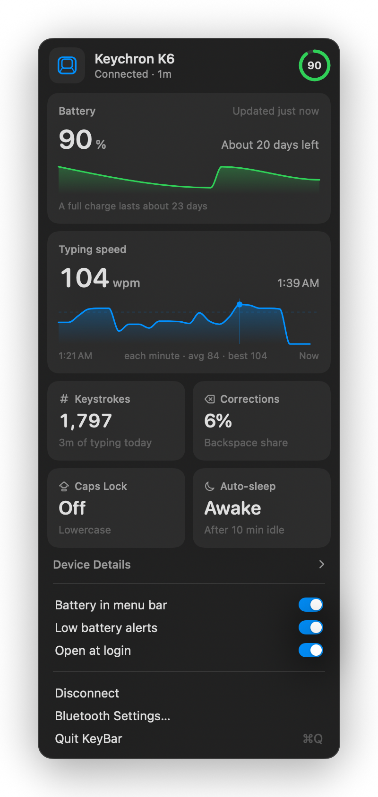

# KeyBar

A small menu bar app for Keychron keyboards connected over Bluetooth.

macOS never shows a Keychron's battery level, even though the keyboard sends it. KeyBar reads it and puts it in your menu bar, with a few other things worth knowing about your keyboard.

<p align="center">
  
</p>

## What it shows

**Battery.** The real percentage, straight from the keyboard. KeyBar keeps a week of readings, so once the battery has drained a little it can tell you roughly how many days you have left. It notices when you plug in and warns you at 20%, 10% and 5%.

**Typing speed.** Your words per minute right now, plus your average and best for the day. Below it is a chart of your day so far. It starts when you first typed and adjusts its detail to fit: minute by minute for a short session, grouped into 5 or 15 minute steps over a long day. The dashed line is your daily average, and hovering shows your speed at any point.

Once you've used it for more than a day, a **Today · 7D · 30D** switch appears. The longer views show your average speed for each day, so you can see whether you're getting faster. Hover a day to see its date and how many keys you typed. KeyBar keeps 90 days of these daily totals. Only real characters count, so Backspace, arrow keys and shortcuts don't inflate the number, and a few seconds of fast typing can't set your best.

**Keystrokes and corrections.** How much you've typed today, how long you spent typing, and how often you reach for Backspace.

**Auto-sleep.** Keychron boards go to sleep after 10 minutes without a keypress. Once you've stopped typing for a minute, KeyBar starts a countdown, so you know why the first key after a coffee break doesn't register.

**Caps Lock**, and in Device Details: firmware version, Bluetooth address, the rate the keyboard reports at (125 Hz on the K6), and whether your top row acts as media keys or F1–F12.

**Connect and disconnect** from the menu, without opening Bluetooth settings.

## What it can't show

Some things live entirely inside the keyboard and are never sent to your Mac:

- the backlight effect and brightness
- the position of the Mac / Windows switch
- which Bluetooth slot (Fn + 1, 2 or 3) you're on

The keyboard handles these in its own firmware. Its Bluetooth description lists every kind of data it can send, and none of these are on the list, so there's nothing for an app to read.

## Install

You need macOS 14 or later and Swift (Xcode or the Command Line Tools).

```sh
git clone https://github.com/aryanranderiya/keybar.git
cd keybar
./scripts/make-signing-cert.sh   # once
./scripts/build.sh --install
```

This builds KeyBar and copies it to `~/Applications`.

The first time you open KeyBar it asks for **Input Monitoring**. The keyboard sends its battery level the same way it sends keypresses, so macOS treats reading it as reading the keyboard. KeyBar keeps counts and timings only. It never stores which keys you pressed, and nothing leaves your Mac.

The signing certificate step is optional, but worth it. Without it, macOS forgets the Input Monitoring permission every time you rebuild.

## Which keyboards work

Any Keychron that connects over Bluetooth and has "Keychron" in its name will show up. Battery level needs the keyboard to report it, which the K-series boards do. If yours doesn't, the battery card says so.

It's been tested on a Keychron K6 with firmware 1.1.11.

## License

MIT
